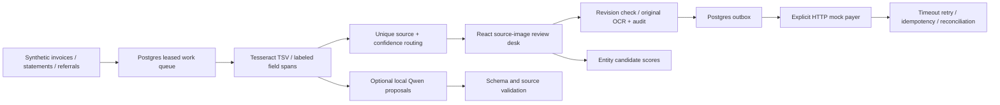

# Docket

Docket extracts synthetic document fields, checks their source evidence, and persists reviewer corrections without erasing the original OCR.

## Result

Actual Tesseract on **36 synthetic pages / 7 fields each**: 11/36 pages fully correct; date 97.22%, amount 91.67%. [Every field/template](docs/results/RESULTS.md).  
Scripted truth-assisted review: **46/56 → 56/56 correct fields** across 8 persisted reviews; independent human accuracy/time savings **not measured**.  
Local Qwen study: **6/6 schema-valid outputs; 18/42 correct fields**, 5/23 nonempty proposals unsupported by the source gate; advisory only. [Actual output](docs/results/model-evaluation.json).

## Architecture



## Run it

Python with venv, Node/npm, Tesseract and PostgreSQL server tools are prerequisites. No real records or paid API/account is needed.

```sh
make demo
# Open http://127.0.0.1:8096 · local-review / local-view · Ctrl-C stops owned services.
make lint test bench
```

[Demo, optional model and recording steps](docs/DEMO.md). The local demo preserves its own ignored Postgres data directory; test/bench clusters are temporary. Compose uses a database volume. **Not deployed.**

## Decisions and limits

- Synthetic PNG ingestion only. Six generator templates with rendered degradation, not real-world document validation. Each field needs a unique labeled OCR span. OCR citations can support an OCR error; image-attested human corrections have a separate evidence class. [Design](docs/DESIGN.md), [ADRs](docs/adr/).
- At the fixed default threshold 0.93, **0/36** evaluated pages auto-route. This conservative default remains unchanged; no calibrated safe-automation claim is made. The full automation/error curve retains lower-threshold fixture results and null rates when nothing is approved.
- Optional LLM generation is real, local and hash-pinned. Its extraction quality is limited; invalid schemas and unsupported fields are rejected, not replaced with fabricated output. The smaller model's complete schema failure and Qwen's envelope-format failure are retained. The model never approves cases or replaces reviewer decisions.
- The reviewer benchmark is truth-assisted script execution, not proof that humans save time or reduce errors. A genuine blinded human review study remains unfinished: **project status partial for that acceptance claim**.
- Postgres leases use a database clock after row-lock acquisition. A real test caught stale publication with transaction-start time; the fix and original failure are retained in [lease-clock-before-fix.log](docs/results/lease-clock-before-fix.log). Concurrent reviewer revisions conflict rather than silently overwrite.
- Payer and eligibility rules are explicitly mock. An actual HTTP timeout after payer commit exercises durable retries and reconciliation; no clinical, financial or company-use claim follows. Raw source/identifiers are excluded from operational logs; finite redaction canary tests are not a universal PHI guarantee.
- Viewer access gets redacted OCR, no images or writes. Local trust-auth Postgres is for synthetic loopback use only. Deployment needs private env credentials and TLS; configuration is prepared only. [Quality report](docs/QUALITY.md).

## Next

Blinded human review accuracy/time study; held-out templates and real-world-safe calibration; more capable model comparisons; PDF/multipage ingestion; reviewed entity linking; real payer contract work only with approved synthetic sandboxes; encrypted storage, individual identities, migration/versioning and hardened deployment. [Interview kit](INTERVIEW.md), [follow-up drill](DRILL.md), [salvage provenance](docs/migration/docket.md).
